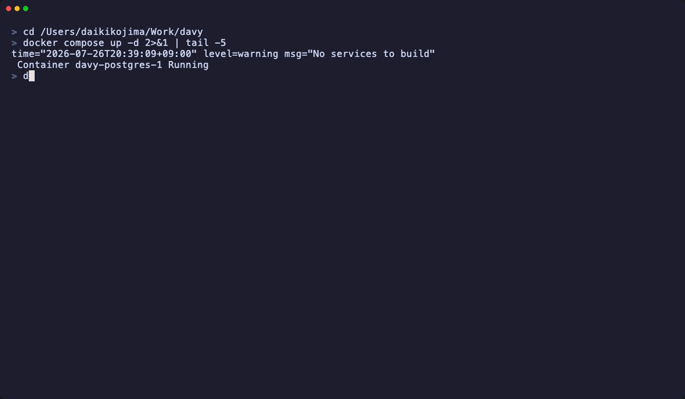

# davy

A terminal SQL client for Postgres, built with [Bun](https://bun.com), [Ink](https://github.com/vadimdemedes/ink), and React.

davy runs in your terminal and gives you a multi-tab SQL editor with schema-aware autocomplete, a scrollable result viewer, and one-key export to CSV, JSON, or Markdown — no browser, no Electron.



## Features

- **Multiple connection profiles** — save any number of Postgres connections and switch between them
- **Multi-tab editor** — open several tabs against the same or different profiles, each with its own query and result
- **Schema-aware autocomplete** — ghost-text suggestions for tables and columns as you type
- **`\d` meta-commands** — `\d` to list tables, `\d <table>` to describe one, same as `psql`
- **Multiple output formats** — Table, CSV, JSON, and Markdown, switchable with a single key
- **Clipboard export** — copy the current result set in the selected format
- **Secure credential storage** — passwords are stored in your OS keychain via `Bun.secrets`, with an option to keep a password for the current session only instead of saving it

## Requirements

- [Bun](https://bun.com) v1.3+
- A reachable Postgres server (see [Local development database](#local-development-database) to spin one up with Docker)
- Linux only: `xclip` or `xsel` for clipboard support (macOS and Windows use the built-in clipboard tools)

## Installation

### Homebrew (macOS, Apple Silicon)

```bash
brew tap jiko21/davy
brew install davy
```

If `brew install` refuses with an "untrusted tap" error (recent Homebrew versions require trusting third-party taps explicitly), run:

```bash
brew trust --formula jiko21/davy/davy
brew install davy
```

### Prebuilt binary (macOS, Linux, Windows)

Download the archive for your platform from the [latest release](https://github.com/jiko21/davy/releases/latest), extract it, and put the `davy` binary on your `PATH`:

```bash
tar -xzf davy-<platform>.tar.gz   # e.g. davy-linux-x64.tar.gz (use unzip for davy-windows-x64.zip)
mv davy-<platform>/davy /usr/local/bin/davy
```

### From source

```bash
git clone https://github.com/jiko21/davy.git
cd davy
bun install
```

## Usage

```bash
davy          # Homebrew or prebuilt binary install
bun start     # from source
```

On first run you'll be walked through creating your first connection profile. After that, davy remembers your profiles and drops you into the profile picker on startup.

### Local development database

A `docker-compose.yml` is included for spinning up a local Postgres instance to connect to:

```bash
docker compose up -d
```

This starts Postgres on `localhost:5432` with database `davy`, user `davy`, and password `davy`.

## Keyboard shortcuts

**Global (main view)**

| Key | Action |
| --- | --- |
| `Ctrl+T` | New tab |
| `Ctrl+W` | Close tab |
| `Ctrl+N` / `Ctrl+B` | Next / previous tab |

**Editor**

| Key | Action |
| --- | --- |
| `Ctrl+X` | Run the current query |
| `Ctrl+L` | Clear the editor |
| `Ctrl+P` | Switch this tab's profile |
| `Tab` | Focus the result panel |
| `→` (at end of line) | Accept the autocomplete suggestion |

**Result panel**

| Key | Action |
| --- | --- |
| `Tab` | Back to editor |
| `f` | Cycle output format (Table → CSV → JSON → Markdown) |
| `c` | Copy the result in the current format |
| `↑` / `↓` | Scroll rows |
| `←` / `→` | Scroll columns |
| `Ctrl+P` | Switch this tab's profile |

## Configuration

Profiles are stored at `~/.config/davy-sql/config.json`. Passwords are never written to that file — they're kept in your OS keychain (or, if you opt out of saving, only in memory for the current process).

## Development

```bash
bun test          # run the test suite
bun build --compile index.ts --outfile davy   # build a standalone binary
```

## License

[MIT](LICENSE) © jiko21
